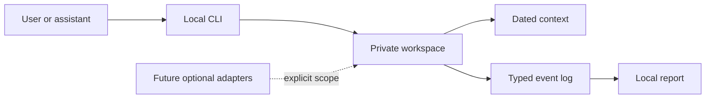

# Architecture

Shareable source and private runtime data are separate.

core.py validates and stores observations; cli.py parses arguments. No model, network
client, browser credential reader, notification sender or service installer is used.
The core is useful without AI.

Events have unique IDs and UTC timestamps. Reports use local calendar days and exclude
future events. Money uses decimal strings. Outcomes reference exact action IDs and
stage counts deduplicate repeated outcomes for an action. Stages aren't additive
people counts. Missing outcomes are unknown and rates don't establish causality.
Resume fingerprints identify bytes, not quality, delivery or application success.

A cross-process lock serializes writes. Atomic replacement keeps the previous complete
file on interruption. The single-user store rewrites the log when appending; very large
histories need a different approach. Request IDs deduplicate identical retries and
reject reused IDs with different content. Schema migrations, correction events and
lock timeouts are future work.

POSIX files are created owner-only; Windows relies on account/directory ACLs. Files
are not encrypted at rest. Use a trusted user account and disk. Local storage doesn't
guarantee local-only AI processing if you let a remote assistant read files.
